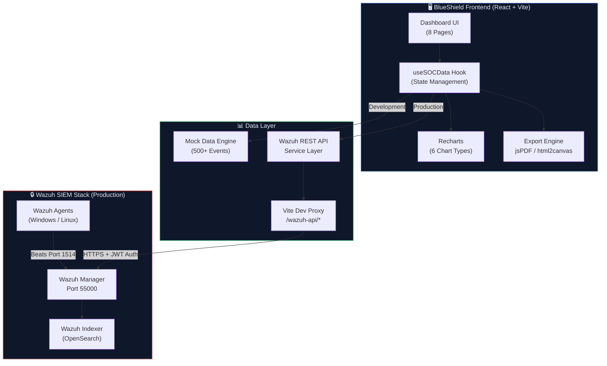
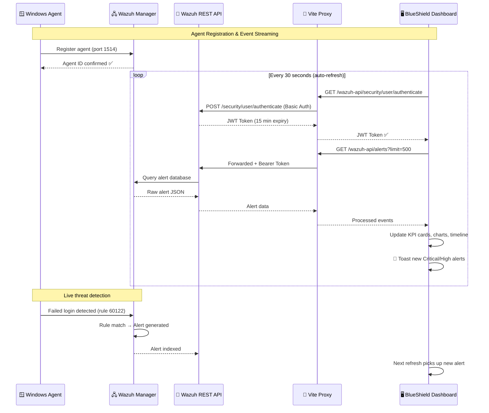
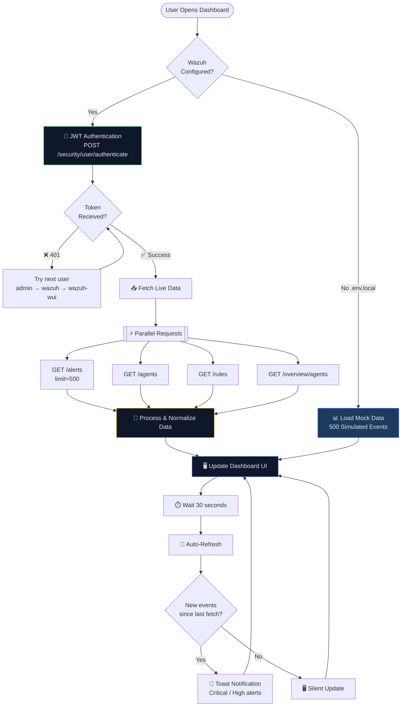
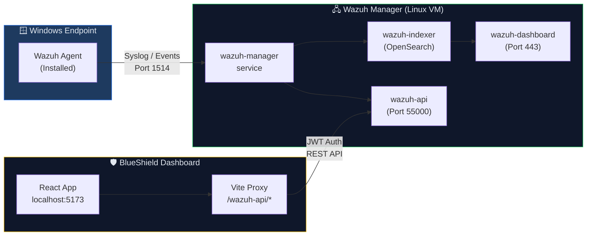
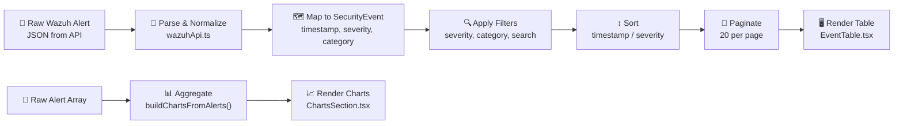

# 🛡️ BlueShield SOC Dashboard

### Security Operations Center Dashboard for Blue Team Monitoring

A modern, interactive Security Operations Center (SOC) dashboard designed to visualize security events, monitor endpoints, support incident response workflows, and provide threat intelligence insights.

Built with React and TypeScript, BlueShield supports simulated security data for demonstration and a Wazuh SIEM integration for live security monitoring.

<div align="center">


</div>

---

Designed to demonstrate security monitoring, alert visualization, endpoint awareness, threat investigation, and incident handling in a unified dashboard.
---

## 📸 Dashboard Preview

| Dashboard Overview | Security Events |
|---|---|
| Real-time KPI cards, 6 interactive charts, attack timeline | Full events table with search, filter, sort, pagination |

| Incident Response | Threat Intelligence |
|---|---|
| 7-stage lifecycle workflow + active incident cards | Global threat map, CVEs, malware families, IOCs |

---

## 🏗️ System Architecture



---

## 🔄 Real-Time Data Flow



---

## 🚨 Incident Response Workflow


---

## 🔐 Authentication & Authorization Flow



---

## 🗂️ Project Structure

```
soc-blueshield/
│
├── 📁 src/
│   ├── 📁 api/
│   │   └── wazuhApi.ts          # Wazuh REST API client + JWT auth
│   │
│   ├── 📁 components/           # All UI components
│   │   ├── Sidebar.tsx           # Navigation + system status
│   │   ├── Topbar.tsx            # Clock, search, notifications
│   │   ├── KPICards.tsx          # 6 animated KPI cards
│   │   ├── ChartsSection.tsx     # 6 interactive Recharts
│   │   ├── EventsTable.tsx       # Events grid (search/filter/sort)
│   │   ├── IncidentResponse.tsx  # Incident management cards
│   │   ├── IncidentWorkflow.tsx  # 7-stage lifecycle visualizer
│   │   ├── ThreatIntel.tsx       # IOCs, CVEs, malware families
│   │   ├── ActiveAgents.tsx      # Endpoint health monitoring
│   │   ├── AttackTimeline.tsx    # Chronological event timeline
│   │   ├── DetectionRules.tsx    # Rule management with toggles
│   │   ├── AuthMonitoring.tsx    # Auth activity & failed logins
│   │   ├── ExportFeatures.tsx    # CSV / PDF / PNG export
│   │   ├── SettingsPage.tsx      # Dashboard configuration
│   │   └── ToastContainer.tsx    # Animated alert notifications
│   │
│   ├── 📁 data/
│   │   └── mockData.ts           # 500+ realistic security events
│   │
│   ├── 📁 hooks/
│   │   ├── useSOCData.ts         # Mock data state + auto-refresh
│   │   └── useWazuhData.ts       # Live Wazuh API state
│   │
│   └── 📁 utils/
│       └── exportUtils.ts        # jsPDF + html2canvas exports
│
├── .env.local                    # Wazuh credentials (not committed)
├── vite.config.ts                # Vite + Wazuh proxy config
└── README.md
```

---

## ⚙️ Tech Stack

| Layer | Technology | Purpose |
|---|---|---|
| **Framework** | React 19 + TypeScript | Component UI |
| **Build Tool** | Vite 8 | Fast dev server + HMR |
| **Styling** | Tailwind CSS v4 + Custom CSS | Dark SOC theme |
| **Charts** | Recharts | Line, Bar, Donut, Radar, Pie |
| **Animations** | Framer Motion | Page transitions, micro-animations |
| **Icons** | Lucide React | 50+ security icons |
| **PDF Export** | jsPDF | Incident report generation |
| **PNG Export** | html2canvas | Dashboard snapshot |
| **SIEM** | Wazuh REST API | Live security events (production) |

---

## 🚀 Quick Start

### 1. Clone the Repository

```bash
git clone https://github.com/nani-arise/soc-blueshield.git
cd soc-blueshield
```

### 2. Install Dependencies

```bash
npm install
```

### 3. Start the Development Server

```bash
npm run dev
```

Open your browser and navigate to:

```text
http://localhost:5173
```

The dashboard starts in **Mock Data Mode**, allowing you to explore the interface without configuring a Wazuh server.

### 4. Connect to Wazuh (Optional)

To enable live security monitoring, configure your Wazuh connection using the environment variables supported by the project.

```env
VITE_WAZUH_HOST=https://YOUR_WAZUH_MANAGER_IP
VITE_WAZUH_PORT=55000
VITE_WAZUH_USER=your_username
VITE_WAZUH_PASS=your_password
```

> **Security:** Never commit real credentials or environment files containing secrets to GitHub.

## 📊 Dashboard Modules

| Module | Description | Capabilities |
|---|---|---|
| **Dashboard Overview** | Centralized security overview | KPI cards, charts, attack timeline |
| **Security Events** | Security event investigation | Search, filtering, sorting, pagination |
| **Incident Response** | Incident tracking and investigation | Incident status management, 7-stage workflow |
| **Threat Intelligence** | Threat data visualization | IOCs, IP intelligence, CVEs, malware insights |
| **Authentication Monitoring** | Login activity analysis | Failed logins, authentication activity |
| **Endpoint Monitoring** | Wazuh agent visibility | Agent status, OS information, resource monitoring |
| **Reports & Export** | Security data reporting | CSV, PDF, PNG exports |
| **Settings** | Dashboard configuration | Notification and display preferences |


## 🔗 Wazuh Integration Map



---

## 📈 Data Pipeline



---

## 🔒 Security & Credential Management

BlueShield uses environment variables to configure its Wazuh integration.

### Security Guidelines

- Never commit `.env.local` or files containing credentials to GitHub.
- Store API usernames and passwords securely.
- Use dedicated credentials for integrations whenever possible.
- Avoid exposing Wazuh API access to untrusted networks.
- Restrict access to your Wazuh Manager according to your environment's security requirements.

### Configuration

The `.env.local` file is intended for local configuration and should remain excluded from version control.

> This project is intended for educational purposes and security monitoring demonstrations. Always configure integrations securely before connecting to a real infrastructure.

## ✨ Key Features

### 📊 Security Monitoring & Dashboard
- Security overview with 6 KPI cards
- Interactive charts for security event visualization
- Attack activity timeline
- Automated dashboard refresh every 30 seconds

### 🚨 Security Event Management
- Centralized view of security events
- Search, filtering, sorting, and pagination
- Monitoring of 500+ simulated events
- Severity-based event visualization

### 🔍 Incident Response
- Interactive 7-stage incident response workflow
- Incident investigation and status tracking
- Visual incident lifecycle management

### 🌍 Threat Intelligence
- Threat indicators and malicious IP visualization
- CVE information and malware family insights
- Geographic threat visualization

### 🖥️ Endpoint Monitoring
- Wazuh agent health and connection status
- Endpoint OS information
- CPU, memory, and last-seen monitoring

### 🔐 Authentication Monitoring
- Login activity visualization
- Failed authentication tracking
- Authentication event analysis

### 📥 Reporting & Export
- Export security events to CSV
- Generate incident reports in PDF
- Export dashboard snapshots in PNG

### 🔔 Notifications & UI
- Severity-based alert notifications
- Animated page transitions
- Responsive dark-themed interface

### 🔗 SIEM Integration
- Wazuh REST API integration
- JWT-based API authentication
- Simulated data mode for demonstrations
- Live monitoring mode when Wazuh is configured


## 👨‍💻 Author

**Y S Nandish**  
Cybersecurity Engineering Student | Blue Team & Security Monitoring

Interested in SIEM, SOC operations, threat detection, incident response, Linux, and cybersecurity research.

- GitHub: [@nani-arise](https://github.com/nani-arise)

---

<div align="center">

*Built with ❤️ for cybersecurity learning and defensive security.*

</div>
